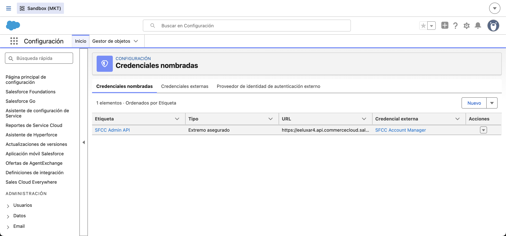
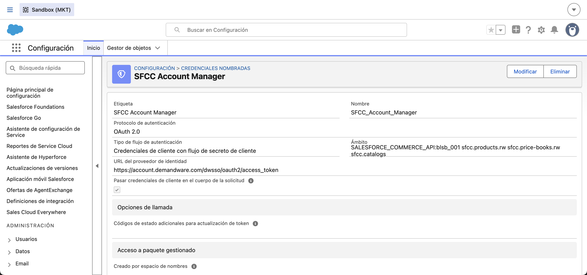

# Configuración del CRM: desbloqueo de despliegues, credenciales y metadata base

Prueba técnica Developer Salesforce · Imagine CX

Registro paso a paso de la Fase B del PRD (`PRD-integracion-ICX.md`) en el sandbox CRM `enterprise-efficiency-9228--mkt` (alias `pruebaTecnicaAnibal`). Cada paso lleva Dónde, Qué se hizo, Resultado y, cuando aplica, su captura en `capturas-configuracion/`.

---

## Fase B · Configurar el CRM

### B.0 Desbloqueo de despliegues: clases obsoletas de la org

**Dónde:** sandbox MKT, clases Apex de Italcol (no son parte de la integración).

**Qué se encontró:** al validar el despliegue de la metadata de la integración, Salesforce rechazó cualquier despliegue a la org, incluso uno trivial de una etiqueta personalizada. La org tenía 42 clases marcadas como inválidas. La causa raíz eran dos clases obsoletas que no compilaban:

| Clase | Error | Origen |
|---|---|---|
| `EnvioPedidoAsync` (9 líneas, ago. 2025) | Llama a `EnvioPedidoService.enviarPedidos(List<Order>)`, método que ya no existe | `EnvioPedidoService` fue reescrita en dic. 2025 y hoy trabaja con pedidos de Consumer Goods Cloud (`cgcloud__Order__c`) |
| `reenviarPedidoController` (13 líneas, ago. 2025) | Llama a `EnvioPedidoService.reintentarPorId(List<Id>)`, método que ya no existe | Misma reescritura |

Las otras 40 clases inválidas solo necesitaban recompilarse: dependían de estas dos. Se descartó que la causa fuera la opción "Compile on Deploy" de la org (está desactivada, verificado en `ApexSettings`).

**Qué se hizo (autorizado por Aníbal):**
1. Se respaldó el cuerpo original de `EnvioPedidoAsync`, `EnvioPedidoAsyncTest`, `reenviarPedidoController` y `reenviarPedidoControllerTest` en la carpeta local `backup-clases-italcol-mkt/`, fuera del repositorio.
2. Se desplegó una versión **desactivada** de `EnvioPedidoAsync` y de `reenviarPedidoController`: se conserva exactamente la misma firma pública (`enviar(Set<Id>)` y `reenviarPedido(Id)` con `@AuraEnabled`) pero sin lógica, con un comentario que explica el motivo y la fecha. Así sus clases de prueba y el componente que invoca al controlador siguen compilando.
3. No se borró ninguna clase ni se tocó `EnvioPedidoService`.

**Resultado:** la org volvió a aceptar despliegues. Una simulación de despliegue (`--dry-run`, sin ejecutar pruebas) de toda la metadata de `icx-integration` se completa sin errores de componente.

**Nota para la sustentación:** `sf project deploy validate` ejecuta por defecto las pruebas de toda la org; las clases de prueba de Italcol tienen 61 % de cobertura y fallos propios, así que en este sandbox el despliegue se hace con `--test-level NoTestRun` y la cobertura de la integración se demuestra ejecutando sus propias clases de prueba.

### B.1 Despliegue de la metadata base de la integración

**Dónde:** desde el proyecto SFDX, con `sf project deploy start --source-dir icx-integration -o pruebaTecnicaAnibal --test-level NoTestRun`.

**Qué se desplegó (30 componentes):**

| Componente | Tipo | Detalle |
|---|---|---|
| `Commerce_Sync_Setting__mdt` + 10 campos + registro `Default` | Custom Metadata | organizationId `f_ecom_blsb_001`, sitio `RefArch`, catálogo `icx-master-catalog`, price book `icx-cop-list-prices`, lista CRM "Lista de precios ICX", moneda `COP`, named credential `SFCC_Admin_API`, lote 20, 2 reintentos, activo |
| `Commerce_Sync_Log__c` + 13 campos | Objeto | Trazabilidad por producto y por ejecución |
| `SFCC_Account_Manager` | External Credential | OAuth 2.0, variante Client Credentials with Client Secret, URL `https://account.demandware.com/dwsso/oauth2/access_token`, scope `SALESFORCE_COMMERCE_API:blsb_001 sfcc.products.rw sfcc.price-books.rw sfcc.catalogs`, principal `ICX_Integration` |
| `SFCC_Admin_API` | Named Credential | URL `https://eeluxar4.api.commercecloud.salesforce.com`, autenticada con la External Credential |
| `ICX_Commerce_Sync` | Permission set | Acceso al principal, al objeto de log y a la pestaña |
| `Commerce_Sync_Log__c` | Tab | Para revisar las ejecuciones |

**Resultado:** `Succeeded`, 30 de 30 componentes, 0 errores (deploy `0AfWD00000HoB890AF`). Verificado con consultas: la Named Credential, la External Credential y el registro `Default` de la Custom Metadata existen en la org con los valores esperados.

### B.2 Asignación del permission set

**Dónde:** `sf org assign permset -n ICX_Commerce_Sync`.

**Resultado:** el permission set `ICX_Commerce_Sync` quedó asignado al usuario `cotesanibal3@gmail.com.mkt`. Sin esta asignación, el usuario no puede usar el principal de la External Credential y los callouts fallarían con error de autorización.

### B.3 Credenciales en Setup: Named Credential, External Credential y principal

**Dónde:** Setup › Seguridad › Credenciales nombradas (pestañas "Credenciales nombradas" y "Credenciales externas").

**Qué se verificó tras el despliegue:**
- La Named Credential **SFCC Admin API** (`SFCC_Admin_API`) apunta a `https://eeluxar4.api.commercecloud.salesforce.com` y usa la External Credential.
- La External Credential **SFCC Account Manager** quedó con protocolo OAuth 2.0, flujo "Credenciales de cliente con flujo de secreto de cliente", el scope completo y la URL del proveedor de identidad de Account Manager. La opción "Pasar credenciales de cliente en el cuerpo de la solicitud" está marcada, que es lo que exige el método `client_secret_post` del API client.
- El principal `ICX_Integration` aparecía como **No configurado**: el Client ID y el Secret no viajan en la metadata, por diseño de Salesforce.

**Qué se hizo:** en la fila del principal, Mostrar acciones › Modificar, se ingresaron el Client ID `a6fb362f-d807-4377-aef1-5d1392cf56b4` y el Client Secret (guardado fuera del repositorio) y se guardó. Este paso lo hizo Aníbal a mano en la interfaz; es el único valor secreto de toda la integración y nunca se escribe en código ni en el repositorio.

**Resultado:** el principal pasó a estado **Configurado**, mostrando el Client ID.

### B.4 Prueba de conexión real desde Apex

**Dónde:** Execute Anonymous con el script `scripts/apex/icx-test-conexion-commerce.apex`. Lee la Custom Metadata, arma las URLs con `callout:SFCC_Admin_API` y hace tres `GET` a Commerce.

**Resultado:**

| Llamada | HTTP | Lectura |
|---|---|---|
| `GET /product/catalogs/v1/.../catalogs/icx-master-catalog` | 200 | El CRM obtuvo el token de Account Manager vía la External Credential y Commerce devolvió el catálogo creado en la Fase A |
| `GET /product/products/v1/.../products/NO-EXISTE-123` | 404 `Product Not Found` | Respuesta esperada; es la señal que usa el job para decidir crear el producto |
| `GET /product/price-books/v1/.../price-books/icx-cop-list-prices` | 404 `Site Not Found` | Ver B.5: este endpoint responde así incluso para price books existentes |

Con esto queda validada toda la cadena de autenticación y conectividad CRM → Account Manager → Commerce sin credenciales en código.

### B.5 Hallazgo: el endpoint `/price-books/{id}` no funciona en este sandbox

**Dónde:** pruebas desde Apex con el script `scripts/apex/icx-test-price-book-api.apex`, y por curl contra price books de la demo.

**Qué se probó y qué respondió la API de Price Books:**

| Llamada | HTTP | Respuesta |
|---|---|---|
| `GET /price-books/usd-m-list-prices` (price book de la demo, existe y está asignado a RefArch) | 404 | `Site Not Found` |
| `GET /price-books/icx-cop-list-prices` | 404 | `Site Not Found` |
| `PUT /price-books/icx-cop-list-prices` (crear en COP) | 404 | `Site Not Found` |
| `POST /price-book-search` (matchAll y termQuery por id) | 200 | Devuelve los price books de la demo correctamente; `total: 0` para el de ICX, que aún no existe |
| `PUT /price-books/icx-cop-list-prices/site-assignments/RefArch` | 404 | `Price Book Not Found` (respuesta coherente: el price book no existe) |
| `PUT /price-books/icx-cop-list-prices/price-book-entries/NO-EXISTE-123` | 404 | `Price Book Not Found` (coherente) |

**Lectura:** el recurso `/price-books/{priceBookId}` (GET y PUT) falla con "Site Not Found" aunque el price book exista, mientras que la búsqueda y los sub-recursos de entradas y asignaciones funcionan con normalidad. La especificación oficial no define ningún parámetro de sitio para ese recurso, así que es un comportamiento de la instancia, no un error de uso.

**Decisión de diseño (ajuste al PRD):**
- El price book `icx-cop-list-prices` se crea **manualmente en Business Manager** (Merchant Tools › Products and Catalogs › Price Books), en COP y asignado al sitio RefArch. Pasa a ser configuración, igual que el catálogo maestro.
- El job **verifica** que exista con `POST /price-book-search` (termQuery por `id`) al iniciar; si no existe, aborta con un error claro en el log en lugar de intentar crearlo.
- Los precios se escriben con `PUT /price-books/{id}/price-book-entries/{productId}`, que sí funciona.

La Fase B termina aquí; lo siguiente es crear el price book en Business Manager (Fase A, pendiente) y la Fase C, el desarrollo Apex.
