# Configuración del sandbox de Commerce: sitio, catálogos y storefront (demo SFRA)

Prueba técnica Developer Salesforce · Imagine CX

Registro paso a paso de la Fase A del PRD (`PRD-integracion-ICX.md`): preparación del sandbox de Commerce `blsb-001`, que estaba vacío, mediante la importación de la demo Storefront Reference Architecture (SFRA). Cada paso lleva su captura; las capturas muestran solo el contenido del sandbox y están en `capturas-configuracion/`.

Convención de cada paso: **Dónde** (ruta en la herramienta), **Qué se hizo**, **Resultado** y la captura.

---

## Fase A · Preparar el sandbox de Commerce (Business Manager `blsb-001`)

### A.1 Punto de partida: Site Import & Export

**Dónde:** Administration › Site Development › Site Import & Export.

**Qué se hizo:** se abrió la página para revisar qué archivos de importación ofrece el sandbox antes de tocar nada.

**Resultado:** el sandbox trae tres opciones de importación: `geolocation-sample.zip`, "SiteGenesis Demo Site" y "Storefront Reference Architecture Demo Sites". No hay procesos de importación previos. La sección Export permite exportar los datos actuales por unidad (Sites, Catalogs, Price Books, etc.).

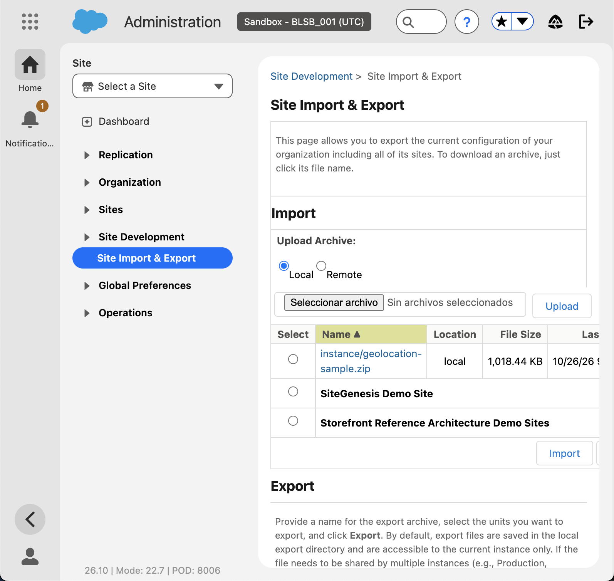

### A.2 Selección del archivo "Storefront Reference Architecture Demo Sites"

**Dónde:** misma página, sección Import.

**Qué se hizo:** se marcó la opción "Storefront Reference Architecture Demo Sites" y se pulsó **Import**.

**Por qué esta opción:** es la tienda de referencia oficial de Salesforce (SFRA). Trae sitios, catálogos, price books e inventario de demo, y es lo que cualquier proyecto real usa como base. SiteGenesis es la arquitectura anterior y ya no se recomienda.

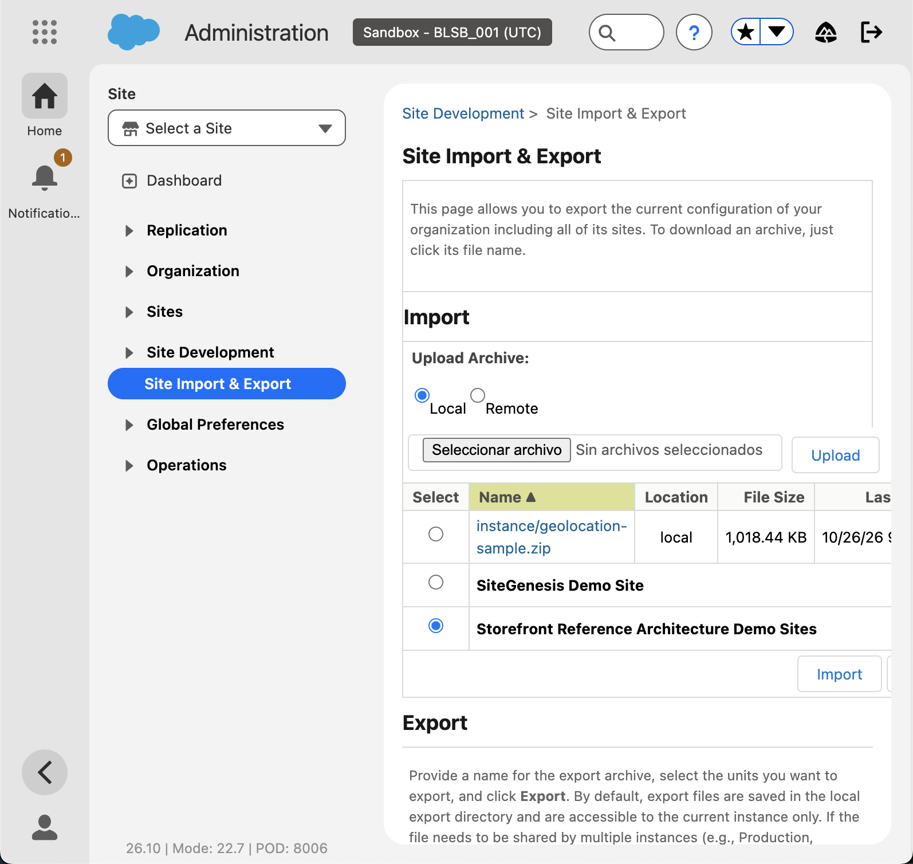

### A.3 Pantalla de configuración de la demo SFRA

**Dónde:** Site Development › Site Import & Export › Storefront Reference Architecture.

**Qué se hizo:** al pulsar Import, Business Manager no importa de inmediato: muestra las configuraciones de demo disponibles.

**Resultado y hallazgo clave:** el texto de la pantalla indica que el despliegue de la demo "instala el código de referencia, los datos de ejemplo, crea un directorio de versión de código y lo activa automáticamente". Es decir, **esta importación también despliega las cartridges de SFRA**, no solo los datos. Con esto la tienda en línea queda disponible sin necesidad de acceso al repositorio privado de SFRA en GitHub, que era el bloqueo identificado en el análisis. CA4 deja de depender de Imagine CX.

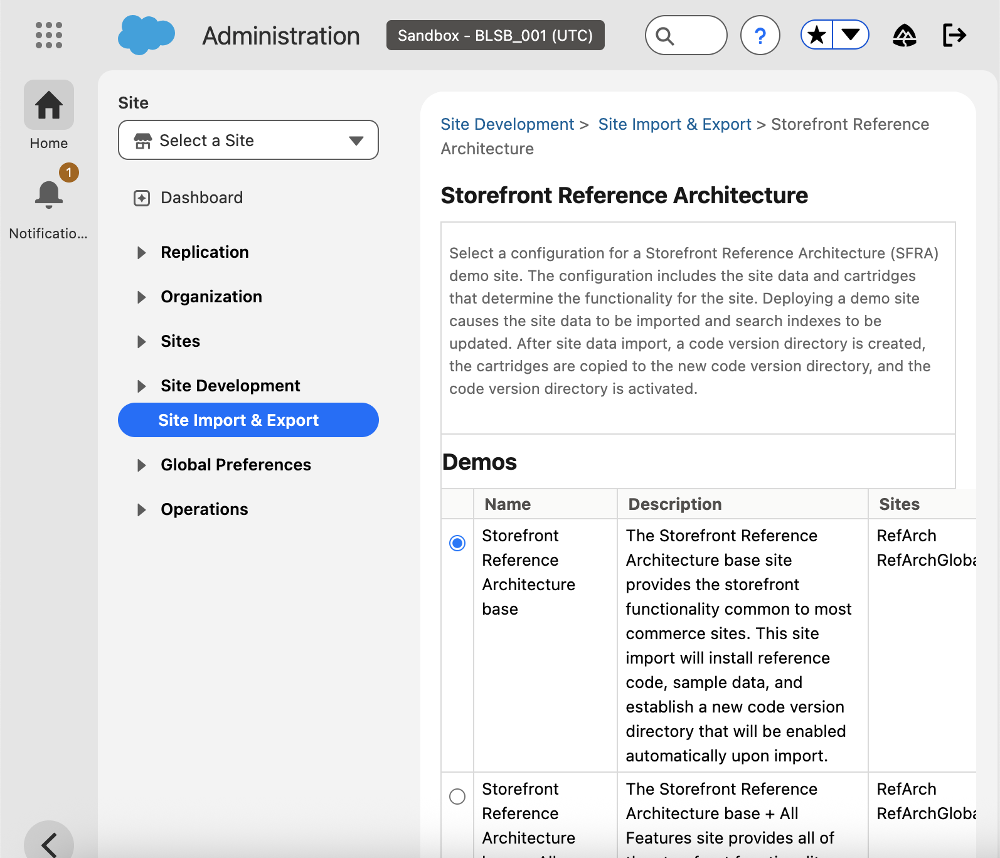

### A.4 Opciones de demo disponibles

**Dónde:** misma pantalla, tabla "Demos".

**Qué se hizo:** se revisaron las cuatro configuraciones:

| Configuración | Sitios | Versión | Comentario |
|---|---|---|---|
| Storefront Reference Architecture base | RefArch, RefArchGlobal | 8.0.0 | Funcionalidad estándar. **Elegida** |
| Base + All Optional Features | RefArch, RefArchGlobal | 8.0.0 | Agrega BOPIS, Wishlist, Gift Registry, Apple Pay, etc. Innecesario para la prueba |
| Base v6.0.0 + Commerce Payments 4.4.0 | RefArch, RefArchGlobal | 6.0.0 | Requiere licencia de Salesforce Payments |
| Base + Optional Features + Commerce Payments | RefArch, RefArchGlobal | 6.0.0 | Igual, requiere licencia |

**Por qué la base:** es la más simple, la más reciente (8.0.0) y suficiente para mostrar un producto en su categoría con nombre y precio. Crea dos sitios: `RefArch` (un idioma, una moneda) y `RefArchGlobal` (varios idiomas y monedas).

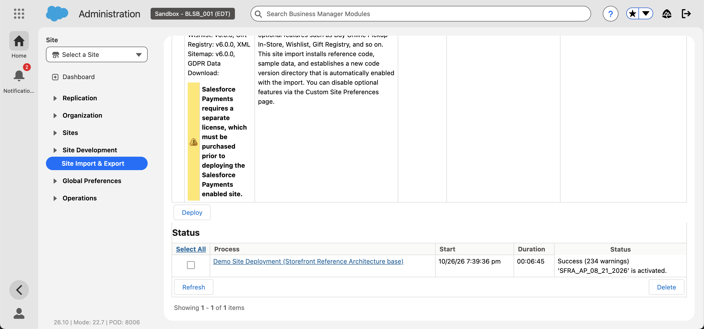

### A.5 Despliegue de la demo y resultado

**Dónde:** misma pantalla, botón **Deploy** y sección Status.

**Qué se hizo:** se pulsó Deploy con la configuración base. El proceso "Demo Site Deployment (Storefront Reference Architecture base)" apareció en estado Running y se consultó su estado cada 30 segundos.

**Resultado:** el proceso terminó en **Success (234 warnings)** en 6 minutos 45 segundos, con el mensaje "'SFRA_AP_08_21_2026' is activated": la versión de código con las cartridges de SFRA quedó creada y activada. Las advertencias son normales en la importación de datos de demo (atributos opcionales, imágenes de ejemplo) y no afectan el resultado.

### A.6 Verificación de la tienda en línea (storefront)

**Dónde:** navegador, URL del sitio RefArch: `https://blsb-001.dx.commercecloud.salesforce.com/on/demandware.store/Sites-RefArch-Site`.

**Qué se hizo:** se abrió la tienda y se aceptó el aviso de consentimiento de rastreo que trae la demo.

**Resultado:** la tienda carga. Título "RefArch | Salesforce Commerce Cloud | 8.0.0", menú con categorías (New Arrivals, Womens, Mens, Electronics), banners y 10 productos con precio en la portada. Es la confirmación de que el bloqueo identificado en el análisis (ausencia de storefront) quedó resuelto sin necesidad del repositorio privado de SFRA.

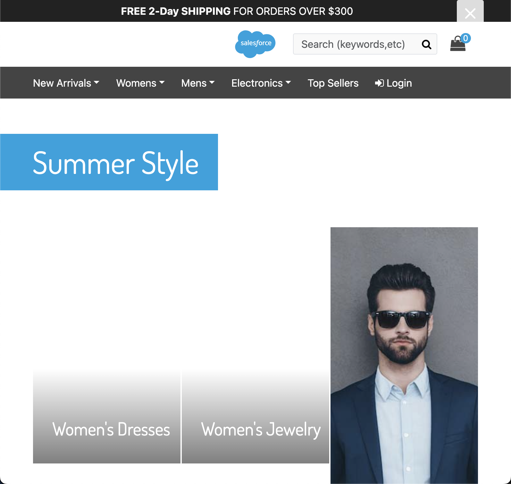

### A.7 Verificación de una página de categoría

**Dónde:** tienda RefArch › Womens › Clothing › Tops (`/s/RefArch/womens/clothing/tops/`).

**Qué se hizo:** se abrió una página de categoría para comprobar el escenario exacto de CA4: productos dentro de su categoría, con nombre y precio.

**Resultado:** la categoría "Tops" lista 12 productos con su nombre y su precio (por ejemplo "Long Sleeve Seamed Shirt", de $74.00 a $54.99). Este es el mismo tipo de pantalla donde se mostrará el producto de la lista ICX una vez el job lo cree y se le asigne categoría.

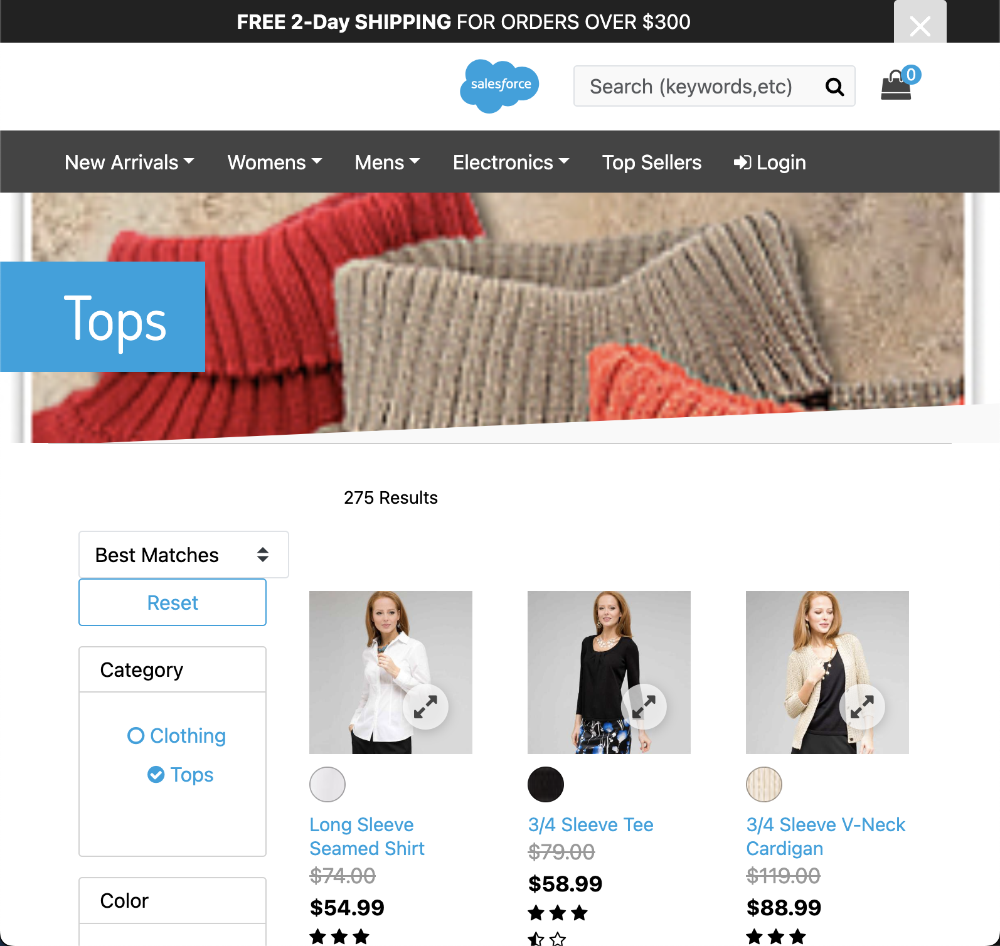

### Datos creados por la importación (consultados por la API de catálogos)

| Catálogo | Tipo | Asignado a sitio |
|---|---|---|
| `apparel-m-catalog` | Maestro (Apparel Master Catalog) | — |
| `electronics-m-catalog` | Maestro (Electronics Master Catalog) | — |
| `storefront-catalog-m-en` | De tienda (Storefront Catalog - EN), con categorías | `RefArch` (online) |
| `storefront-catalog-m-non-en` | De tienda (Storefront Catalog - Non-EN) | `RefArchGlobal` (online) |

Cartridge path de los sitios: `app_storefront_base:plugin_apple_pay:plugin_facebook:plugin_payments:plugin_pinterest_commerce:plugin_web_payments:bc_content:core`.

Decisión para la integración: el job creará los productos en un catálogo maestro (se usará `apparel-m-catalog` o uno propio) y la categoría se asignará manualmente en `storefront-catalog-m-en`, que es el catálogo del sitio `RefArch`.

### A.8 Sitios creados en Business Manager

**Dónde:** Administration › Sites › Manage Sites.

**Resultado:** la lista, que antes decía "no Storefront sites", ahora muestra dos sitios en estado Online: **RefArch** y **RefArchGlobal**. RefArch es el sitio que se usará para la demo (un idioma, una moneda); RefArchGlobal es la variante multi-idioma y multi-moneda de la demo.

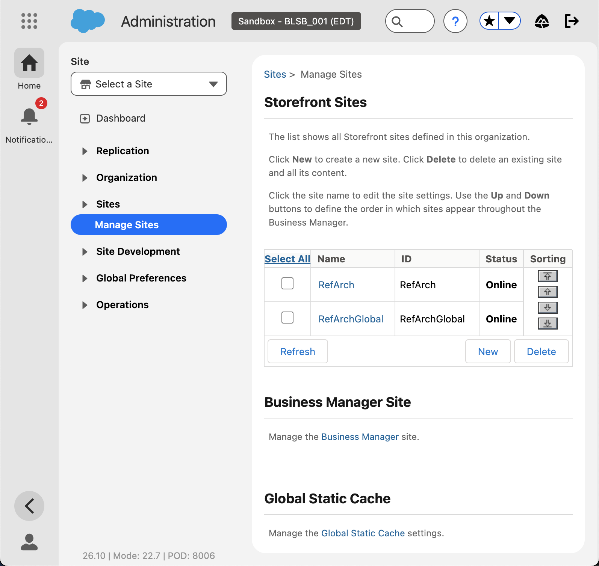

### A.9 Configuración general del sitio RefArch

**Dónde:** Manage Sites › RefArch › pestaña General.

**Qué se hizo:** revisión de solo lectura. No se modificó nada.

**Resultado:** el sitio tiene ID `RefArch`, nombre "RefArch" y **moneda por defecto US Dollar**. Pendiente para el siguiente paso: la Lista de precios ICX está en COP, así que hay que habilitar COP en el sitio (o decidir si el price book de la demo se crea en la moneda del sitio). Esto se resuelve en el paso 3 de la Fase A del PRD antes de correr el job.

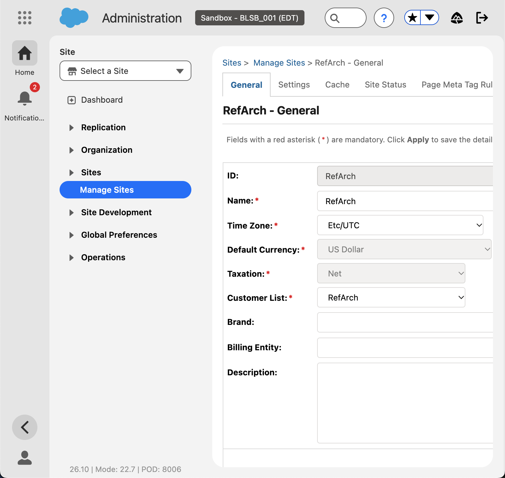

### A.10 Versión de código activa

**Dónde:** Administration › Site Development › Code Deployment.

**Resultado:** aparece la versión **SFRA_AP_08_21_2026** como activa (creada y activada a las 7:46 pm, hora del sandbox), junto a `version1`, que era la versión vacía inicial. Esta versión contiene las cartridges de SFRA 8.0.0 que hacen funcionar la tienda.

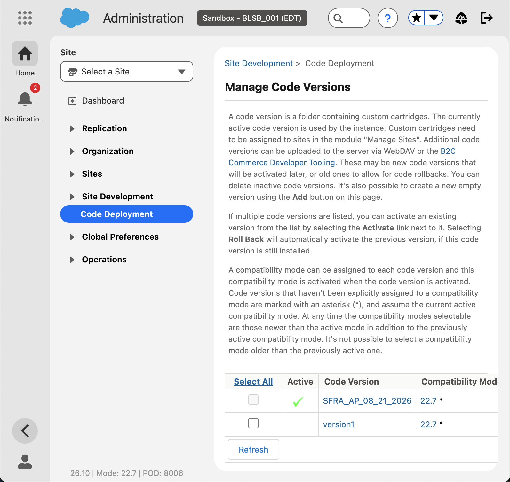

### A.11 Moneda COP habilitada en el sitio RefArch

**Dónde:** Merchant Tools (sitio RefArch) › Site Preferences › Currencies.

**Qué se hizo:** la Lista de precios ICX está en pesos colombianos y el sitio RefArch de la demo solo permitía USD, EUR, JPY y CNY (la moneda por defecto, USD, no se puede cambiar una vez creado el sitio). Se pulsó **Add**, se marcó "COP Colombian Peso" en el diálogo "All Currencies" y se confirmó.

**Resultado:** COP aparece en la lista de monedas permitidas del sitio. Con esto el price book en COP que creará el job se podrá asignar al sitio y la tienda podrá mostrar los precios en pesos.

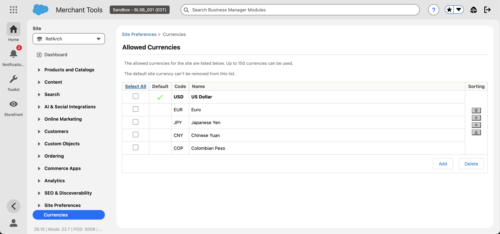

### A.12 Catálogo maestro propio para la integración

**Dónde:** Merchant Tools (sitio RefArch) › Products and Catalogs › Catalogs.

**Qué se hizo:** la demo trae dos catálogos maestros (`apparel-m-catalog`, `electronics-m-catalog`) y dos de tienda. Para no mezclar los productos de Italcol con los de la demo, se creó un catálogo maestro propio con **New**: ID `icx-master-catalog`, nombre "ICX Master Catalog (Italcol)" y una descripción que indica que sus productos los crea el job desde la Lista de precios ICX del CRM.

**Resultado:** el catálogo aparece en la lista junto a los cuatro de la demo, en estado Online, con 0 productos. Es el valor de `owningCatalogId` que usará el job (campo `Catalog_Id__c` de la Custom Metadata). La categoría se seguirá asignando a mano en `storefront-catalog-m-en`, el catálogo del sitio RefArch.

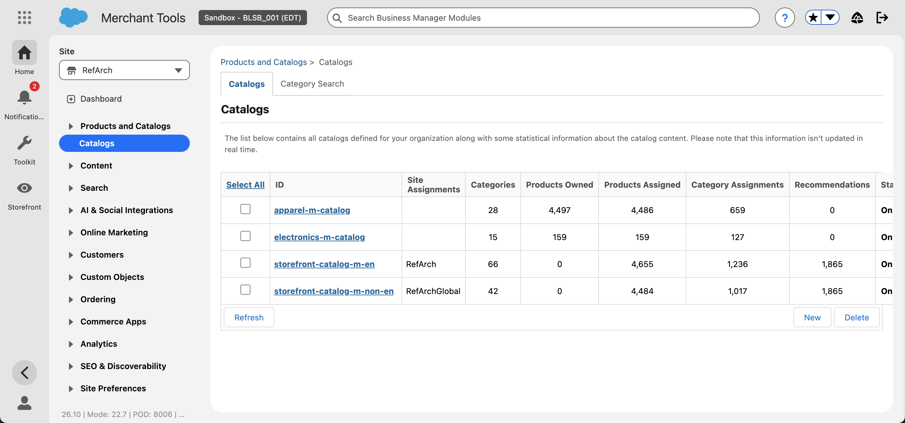

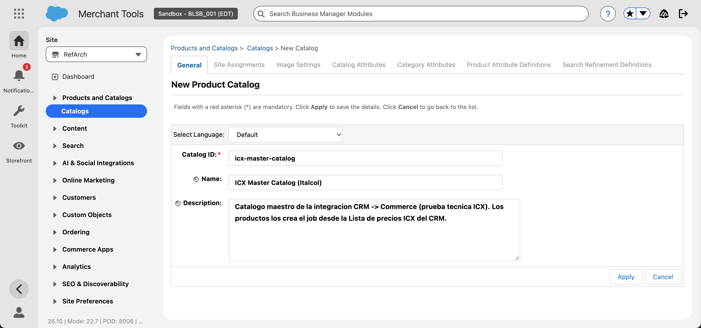

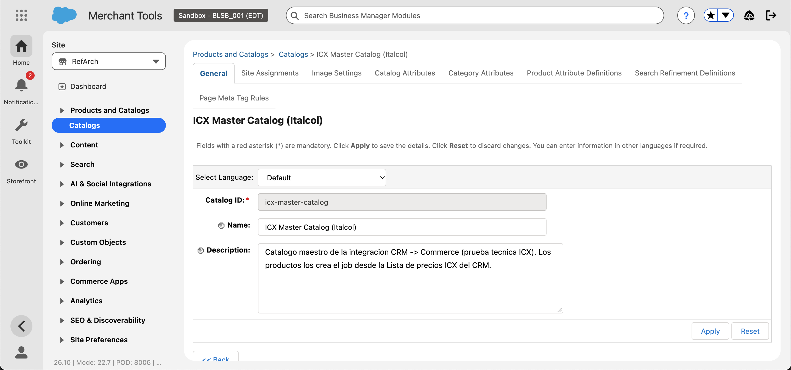

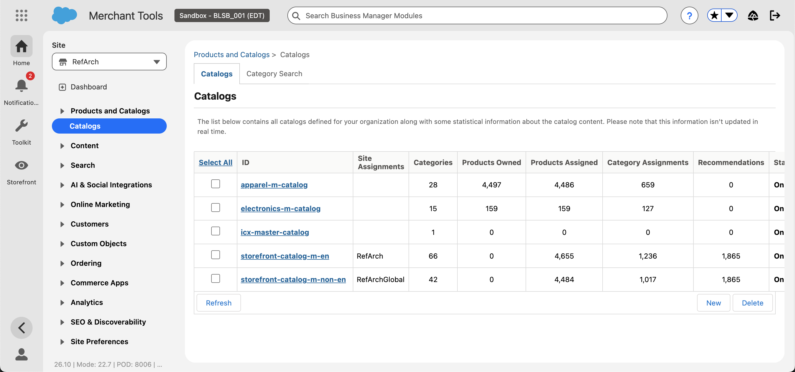

**Conclusión de la Fase A:** el sandbox pasó de vacío a tener dos sitios online, cuatro catálogos, price books e inventario de demo y la tienda SFRA funcionando. El bloqueo del storefront quedó resuelto por nosotros, sin acceso al repositorio privado. La moneda COP quedó habilitada en el sitio RefArch y el catálogo maestro `icx-master-catalog` creado para el job. Valores para la Custom Metadata del CRM: sitio `RefArch`, catálogo `icx-master-catalog`, price book `icx-cop-list-prices`, moneda `COP`.

