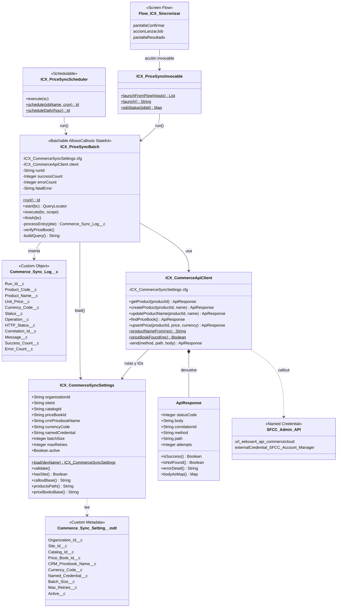
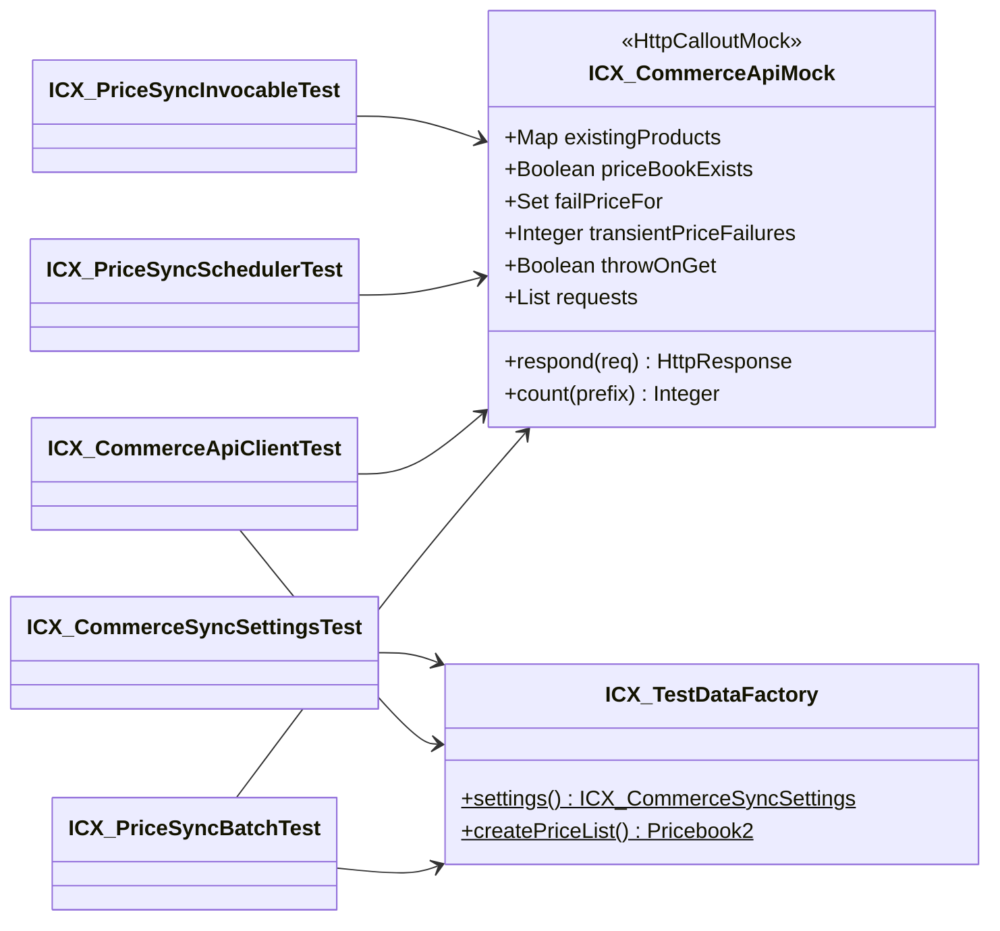

# Diagrama de clases · Integración Lista de precios ICX (CRM → B2C Commerce)

Prueba técnica Developer Salesforce · Imagine CX · Autor: Anibal Cortes

El diagrama muestra las cinco clases de la integración (paquete `icx-integration`), los puntos de entrada, el objeto de log, la Custom Metadata y las clases de prueba. Las flechas indican quién usa a quién.

## Clases de prueba

## Responsabilidad de cada clase

| Clase | Capa | Responsabilidad |
|---|---|---|
| `ICX_PriceSyncInvocable` | Entrada | Lanzar el job desde Flow, Lightning o Execute Anonymous y consultar su estado |
| `ICX_PriceSyncScheduler` | Entrada | Ejecución programada (cron) |
| `ICX_PriceSyncBatch` | Orquestación | Regla de negocio por producto: GET → crear o actualizar nombre → upsert precio; log y resumen |
| `ICX_CommerceApiClient` | Acceso externo | Único punto con HTTP: Products API y Price Books API, reintentos y errores |
| `ICX_CommerceSyncSettings` | Configuración | Lee y valida la Custom Metadata; construye rutas |
| `ICX_CommerceApiMock` | Pruebas | Simula Commerce por método y URL |
| `ICX_TestDataFactory` | Pruebas | Configuración inyectada y lista de precios de prueba |
