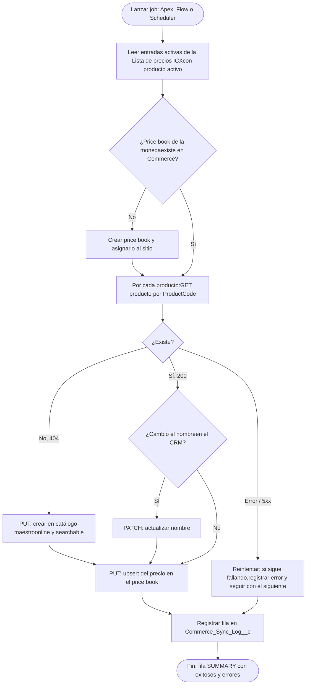

Prueba técnica · Imagine CX · entrega 28 oct 2026

# Mapa de la integración ICX

Cómo viajan los productos y precios de la Lista de precios ICX desde el CRM hasta la tienda de B2C Commerce, y qué falta para tenerlo funcionando en la sustentación.

Código y pruebas listos Falta acceso a los sandboxes Falta configuración en ambos ambientes

## Arquitectura

Todo corre dentro del CRM con Apex nativo. El CRM pide un token a Account Manager y llama a las Admin APIs de Commerce (SCAPI). La asignación de categorías, el índice y la vista en la tienda se hacen a mano en Business Manager.

CRM (lo construimos) Autenticación Commerce (lo escribe el job) Commerce (manual en Business Manager)

## Funcionalidad: qué hace el job en cada ejecución

Cada ejecución deja Commerce igual al CRM. El producto se busca por su código y solo se crea si no existe; el precio se escribe siempre con un upsert, así correr el job varias veces no duplica nada.

## Mapeo de campos

| CRM | B2C Commerce | Regla |
| --- | --- | --- |
| `Product2.ProductCode` | `product.id` y `productId` del precio | Llave única en ambos sistemas; evita duplicados |
| `Product2.Name` | `product.name.default` | Se crea con el producto y se actualiza si cambia |
| `PricebookEntry.UnitPrice` | Precio, cantidad mínima 1 | Upsert en cada ejecución |
| Moneda de la entrada o del org | Moneda del price book `icx-list-prices-{moneda}` | Debe coincidir con la moneda del sitio |
| Configuración | Catálogo maestro, online y searchable | Las categorías no se tocan |

## Qué hay que hacer

### Ya está hecho

Claude

- hechoClases Apex: batch, servicio, cliente SCAPI, scheduler e invocable para Flow
- hechoCustom Metadata de configuración, objeto de log y permission set
- hechoClases de prueba con Commerce simulado: CA1, CA2, CA3 y errores
- hechoREADME con setup, mapeo y respuesta sobre manejo de errores

### 1. Accesos

Tú

- bloqueaConseguir Client ID y Secret de la API de Commerce (pedírselos a Laura o crear el API client en Account Manager)Scopes: sfcc.products.rw y sfcc.price-books.rw
- bloqueaAnotar Short Code y Organization Id en Business ManagerAdministration › Site Development › Salesforce Commerce API Settings
- bloqueaHabilitar en el entorno los dominios de Salesforce y Commerce, o desplegar desde tu equipo con sf CLI
- pendienteCrear un repo vacío en GitHub para subir el código

### 2. Setup en el CRM

Juntos

- pendienteCrear External Credential (OAuth client credentials) con el principal
- pendienteCrear Named Credential `SFCC_Admin_API` con la URL del short code
- pendienteAjustar la Custom Metadata: catálogo maestro y sitio reales
- pendienteDesplegar, correr pruebas (≥75 %) y asignar el permission set
- pendienteRevisar que los 4 productos tengan ProductCode y anotar la moneda

### 3. Commerce y tienda

Tú en BM

- pendienteConfirmar que la moneda del sitio coincide con la del CRM
- pendienteCorrer el job y verificar los 4 productos y precios en BM (CA1)
- pendienteCrear categorías Huevos y Embutidos y asignar los productos
- pendienteDesmarcar “Show Orderable Products Only” o dar inventario perpetuo
- pendienteReconstruir el índice, invalidar caché y verificar la tienda (CA4)

### 4. Sustentación

Tú

- pendienteEnsayar CA2: agregar un producto a la lista y correr el job
- pendienteEnsayar CA3: correr de nuevo y cambiar un precio
- pendienteDejar el job programado (suma puntos)
- pendientePreparar la explicación de errores: reintentos, log, idempotencia y mejoras

**Riesgo a verificar primero**

La API de Price Books de SCAPI es reciente. Apenas tengamos credenciales hay que probar un GET contra el sandbox; si no está habilitada, el plan B es cargar los precios con la OCAPI Data API o con un archivo de importación.