# Pruebas funcionales de la integración ICX (Fases D y E)

Prueba técnica Developer Salesforce · Imagine CX · Autor: Anibal Cortes

Registro de las Fases D y E del PRD: datos de prueba en el CRM y ejecución real del job contra el sandbox de Commerce `blsb-001`, validando los criterios de aceptación CA1 a CA4. Cada paso lleva Dónde, Qué se hizo, Resultado y, cuando aplica, su captura en `capturas-configuracion/`.

---

## Fase D · Datos en el CRM

### D.1 Estado inicial de la Lista de precios ICX

**Dónde:** CRM, Pricebook2 "Lista de precios ICX" (`01sWD000003C0H3YAK`).

**Qué se encontró:** dos entradas, no las cuatro que describe la prueba: CARNES (código `1020`, 35.400, producto activo) y POLLOS (código `2020`, 23.400, **producto inactivo**). No se modificó ninguna de las dos: que POLLOS esté inactivo sirve justamente para demostrar que el job filtra productos inactivos.

### D.2 Productos de ejemplo agregados

**Dónde:** Execute Anonymous con `scripts/apex/icx-datos-ejemplo-lista-icx.apex`.

**Qué se hizo:** se crearon tres productos activos con código, su entrada en el price book estándar (requisito de Salesforce) y su entrada en la Lista de precios ICX:

| ProductCode | Nombre | Precio (COP) |
|---|---|---|
| `ICX-HUE-AA30` | Huevos AA x30 | 18.500 |
| `ICX-HUE-AAA12` | Huevos AAA x12 | 9.800 |
| `ICX-EMB-SAL500` | Salchicha ranchera 500g | 12.900 |

**Resultado:** la lista queda con cinco entradas, cuatro con producto activo y con código (las que sincroniza el job) y una excluida (POLLOS).

## Fase E · Ejecución del job y criterios de aceptación

### E.1 CA1 · Carga inicial

**Dónde:** Execute Anonymous, `ICX_PriceSyncBatch.run()` (`scripts/apex/icx-ejecutar-job.apex`). Equivale a ejecutar el Screen Flow "ICX · Sincronizar Lista de precios con Commerce".

**Resultado:** job `707WD0000AT73ZyYQJ` completado en 4 segundos. Log en `Commerce_Sync_Log__c`:

| Log | Producto | Operación | HTTP | Precio |
|---|---|---|---|---|
| SYNC-000000 | `1020` CARNES | producto creado + precio creado | 201 | 35.400 COP |
| SYNC-000001 | `ICX-EMB-SAL500` | producto creado + precio creado | 201 | 12.900 COP |
| SYNC-000002 | `ICX-HUE-AA30` | producto creado + precio creado | 201 | 18.500 COP |
| SYNC-000003 | `ICX-HUE-AAA12` | producto creado + precio creado | 201 | 9.800 COP |
| SYNC-000004 | SUMMARY | Ejecución finalizada | — | exitosos 4, errores 0 |

POLLOS no aparece: el filtro `Product2.IsActive = true` lo excluyó, como pide la regla "productos activos".

**Evidencia en Business Manager y en el CRM:**

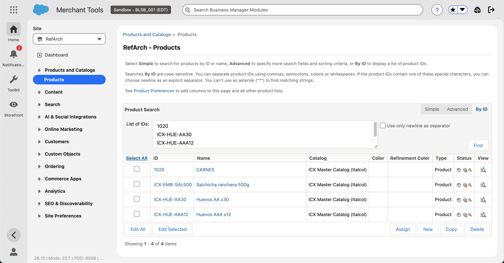

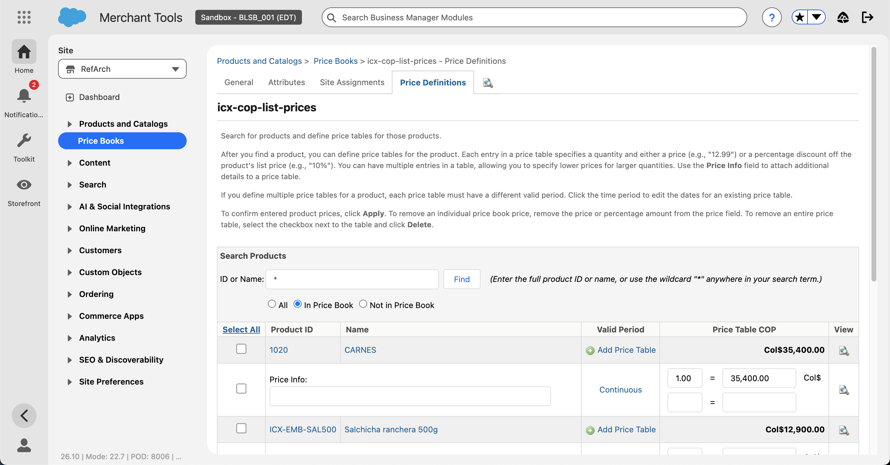

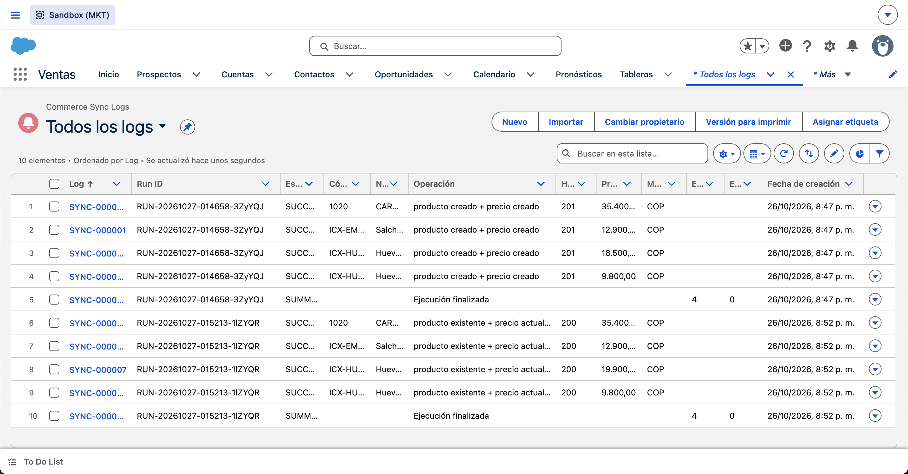

Verificación adicional por API (GET de cada producto y de cada entrada de precio): los cuatro productos existen en `icx-master-catalog`, con `onlineFlag` y `searchable` en `true` para el sitio RefArch, y sus precios en COP con cantidad 1.

### E.2 CA3 · Re-ejecución sin duplicados y precio actualizado

**Qué se hizo:** en el CRM se cambió el precio de "Huevos AA x30" (`ICX-HUE-AA30`) de 18.500 a 19.900 (`scripts/apex/icx-ca3-cambiar-precio.apex`) y se ejecutó el job por segunda vez.

**Resultado:** job `707WD0000AT71lZYQR`, 2 segundos, 4 exitosos y 0 errores. Las cuatro filas dicen **"producto existente + precio actualizado"** con HTTP 200: ningún PUT de creación, ningún duplicado. En Commerce el precio de `ICX-HUE-AA30` pasó a 19.900 COP y el producto sigue teniendo una sola tabla de precios (verificado por API y en la captura E02).

### E.3 CA2 · Producto nuevo agregado en vivo

**Qué se hizo:** se agregó a la lista ICX un producto nuevo, "Chorizo santarrosano 400g" (`ICX-EMB-CHO400`, 15.700), con `scripts/apex/icx-ca2-producto-nuevo.apex`, simulando lo que hará Imagine CX durante la sesión, y se ejecutó el job por tercera vez.

**Resultado:** job `707WD0000AT59aYYQR`, 5 exitosos y 0 errores. El nuevo producto aparece como **"producto creado + precio creado"** (HTTP 201) y los otros cuatro como existentes con precio actualizado (200). El log acumulado del CRM muestra las tres ejecuciones.

### E.4 CA4 (parte 1) · Categorías y asignación manual en Business Manager

**Dónde:** Merchant Tools (sitio RefArch) › Products and Catalogs › Catalogs › Storefront Catalog - EN.

**Qué se hizo:**
1. En el catálogo de la tienda (`storefront-catalog-m-en`, el que usa el sitio RefArch) se crearon dos categorías raíz con **New**: `huevos` "Huevos" y `embutidos` "Embutidos", online.
2. En la pestaña Category Attributes de cada una se marcó **Show in Menu Navigation**, el atributo que SFRA usa para mostrarlas en el menú principal de la tienda.
3. Desde cada categoría, con **Assign** y búsqueda por ID, se asignaron los productos: Huevos ← `ICX-HUE-AA30`, `ICX-HUE-AAA12`; Embutidos ← `ICX-EMB-SAL500`, `ICX-EMB-CHO400`, `1020` (CARNES).

Esta es la asignación manual que la prueba pide explícitamente que no haga la integración.

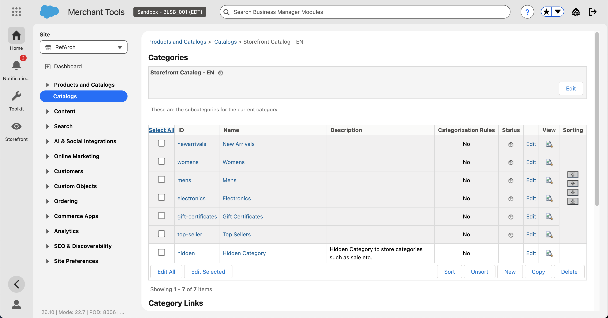

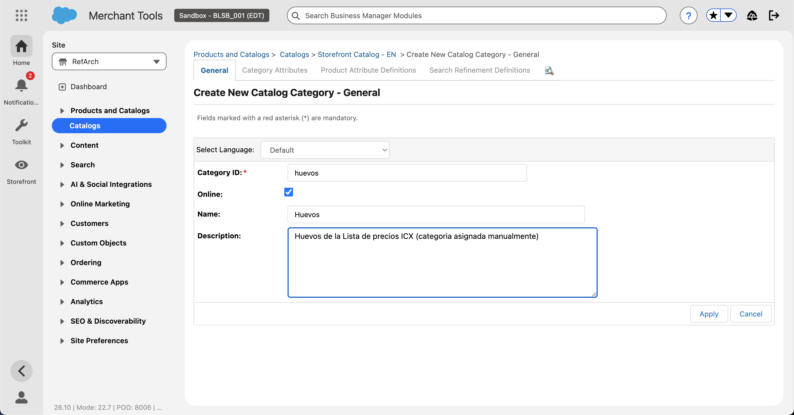

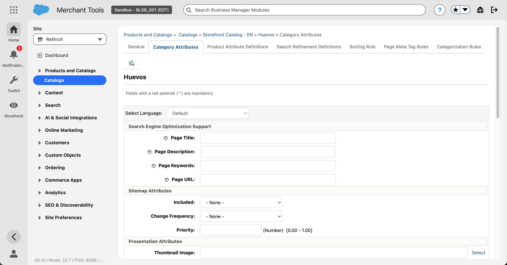

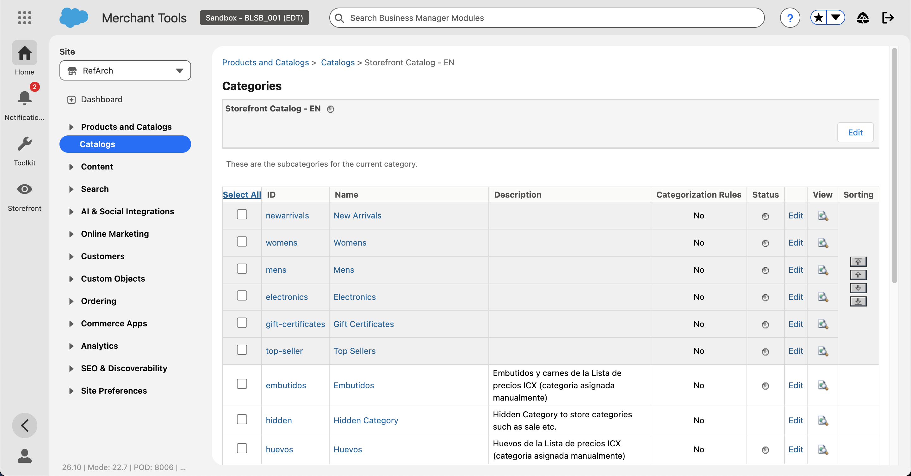

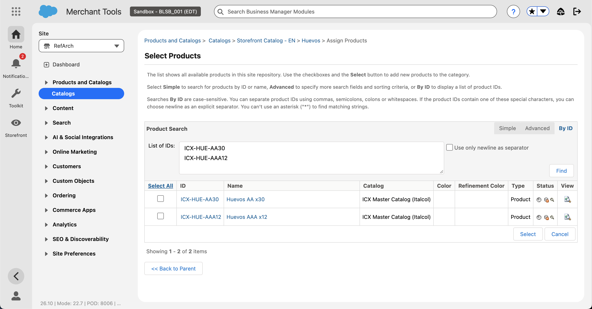

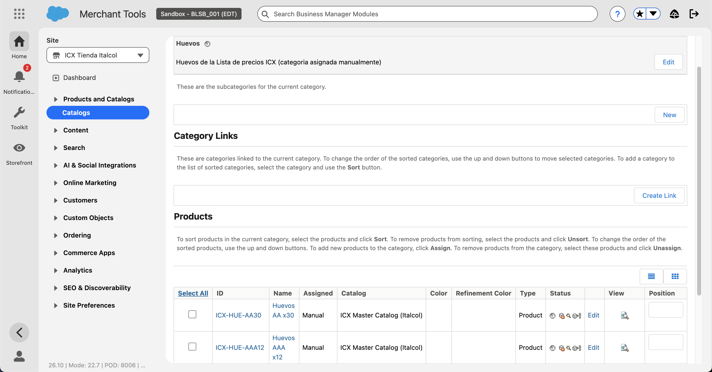

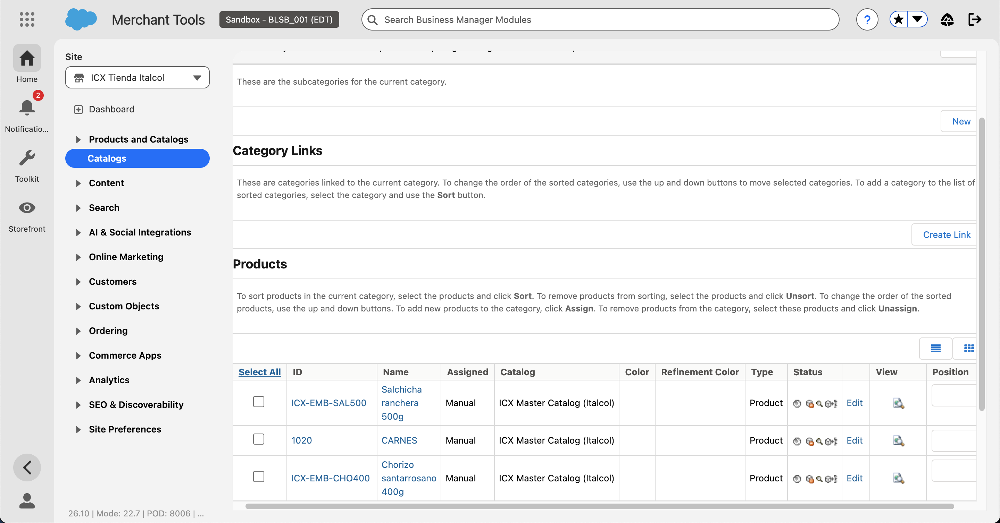

### E.5 CA4 (parte 2) · Índice de búsqueda y verificación en la tienda RefArch

**Dónde:** Merchant Tools (RefArch) › Search › Search Indexes › Rebuild (Product, Availability y Suggestion).

**Resultado:** el índice de productos se reconstruyó en unos 40 segundos. En la tienda RefArch, la página `/s/RefArch/huevos/` ya lista "Huevos AAA x12" y "Huevos AA x30", y el menú principal muestra "Embutidos" y "Huevos". **Pero el precio salía vacío**: SFRA fuerza la moneda de la sesión según el idioma (archivo `countries.json` de las cartridges: en_US → USD, fr_FR → EUR, etc.) y nuestros productos solo tienen precio en COP. Se comprobó en RefArchGlobal: cambiar de idioma cambia la moneda, pero pedir otra moneda sin cambiar el idioma no tiene efecto.

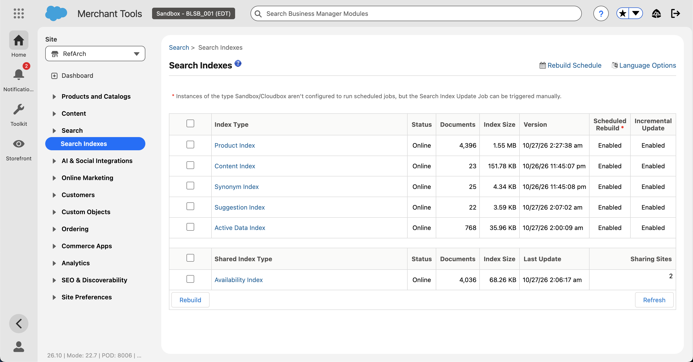

### E.6 CA4 (parte 3) · Sitio ICX en pesos colombianos

**Decisión:** en lugar de modificar el código de SFRA (agregar es_CO → COP en `countries.json` y desplegar cartridges), se creó un **sitio propio "ICX"** cuya moneda por defecto es COP. Como en ese sitio el dólar no está permitido, SFRA no puede cambiar la sesión a USD y los precios en pesos se muestran. No se tocó código de la tienda; todo fue configuración en Business Manager.

**Pasos:**

| # | Dónde | Qué se hizo |
|---|---|---|
| 1 | Administration › Sites › Manage Sites › New | Sitio `ICX` "ICX Tienda Italcol", zona horaria America/Bogota, moneda por defecto **Colombian Peso**, impuestos Net, lista de clientes nueva |
| 2 | Manage Sites › ICX › Settings | Cartridges: la misma ruta de RefArch (`app_storefront_base:plugin_apple_pay:plugin_facebook:plugin_payments:plugin_pinterest_commerce:plugin_web_payments:bc_content:core`). Site Status: Online |
| 3 | Catalogs › storefront-catalog-m-en › Site Assignments | Se asignó el catálogo de tienda (con las categorías Huevos y Embutidos) al sitio ICX |
| 4 | Price Books › icx-cop-list-prices › Site Assignments | Se asignó el price book en COP al sitio ICX |
| 5 | CRM, Custom Metadata `Default` | `Site_Id__c` pasó de `RefArch` a `ICX` |
| 6 | Job | Se amplió `ICX_PriceSyncBatch`: si un producto ya existe pero no está online y buscable para el sitio configurado, hace un PATCH de `onlineFlag` y `searchable` (operación "visible en ICX"). Nueva prueba unitaria; 25 pruebas, 96 % de cobertura. Se ejecutó el job: los 5 productos quedaron "producto existente + visible en ICX + precio actualizado" |
| 7 | Merchant Tools (ICX) › Search › Search Indexes › Rebuild | Índice de productos del sitio ICX construido (4.396 documentos) |

**Resultado (CA4 cumplido):** en la tienda ICX, `https://blsb-001.dx.commercecloud.salesforce.com/s/ICX/huevos` lista "Huevos AAA x12 Col$9,800.00" y "Huevos AA x30 Col$19,900.00"; `/s/ICX/embutidos` lista "CARNES Col$35,400.00", "Chorizo santarrosano 400g Col$15,700.00" y "Salchicha ranchera 500g Col$12,900.00"; la página de producto `/s/ICX/ICX-HUE-AA30.html` muestra nombre y precio Col$19,900.00. El menú principal muestra las dos categorías. La disponibilidad aparece como "no disponible" porque el inventario está fuera del alcance de la prueba.

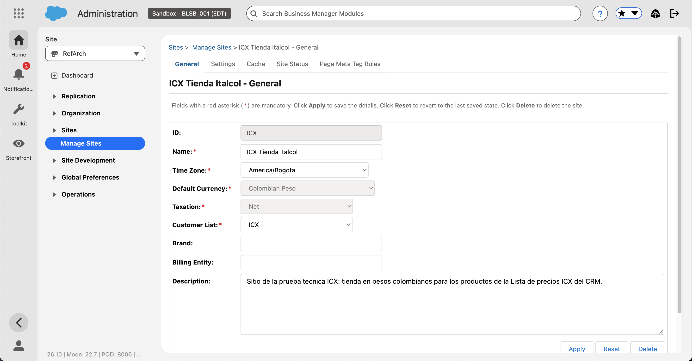

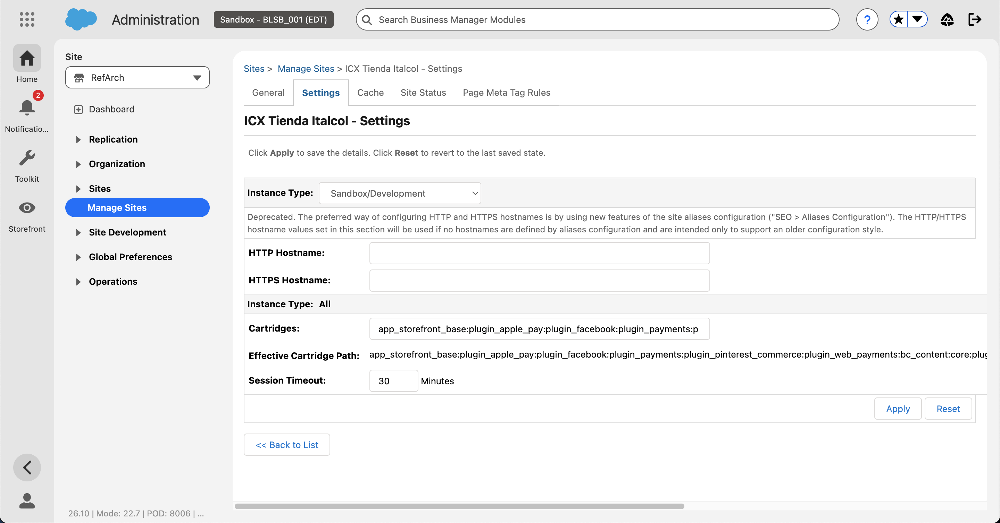

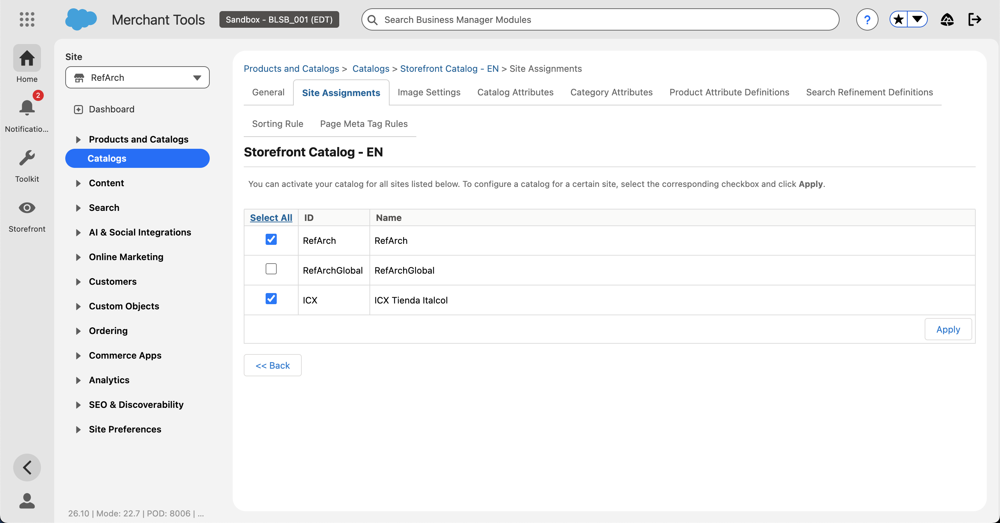

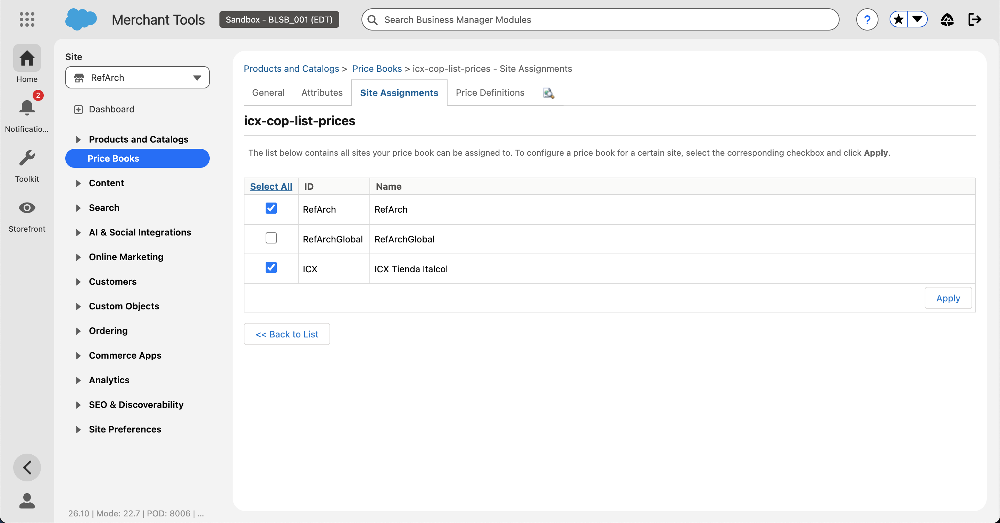

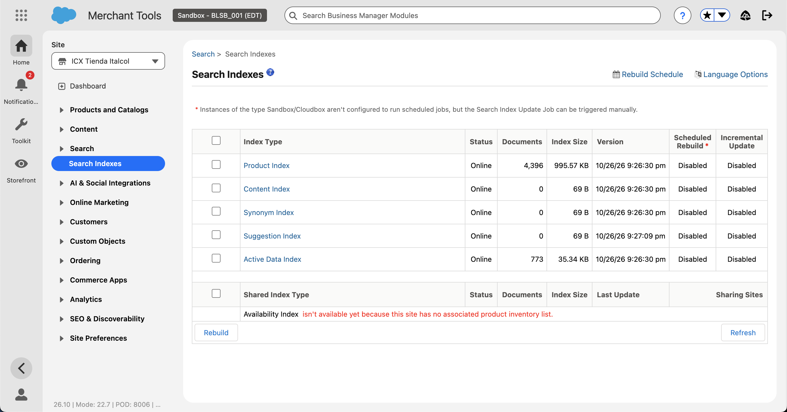

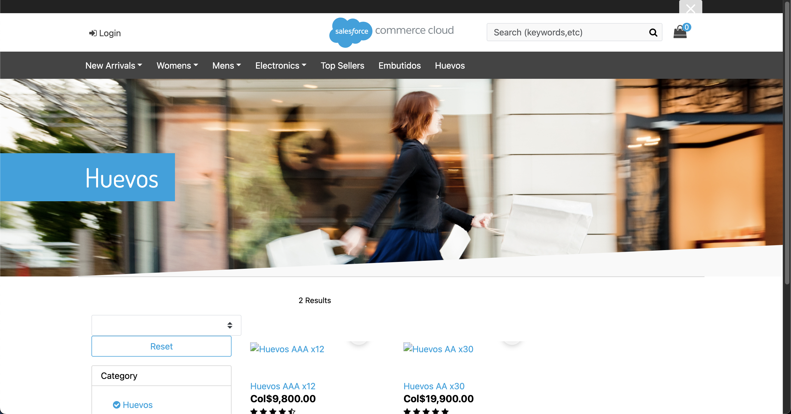

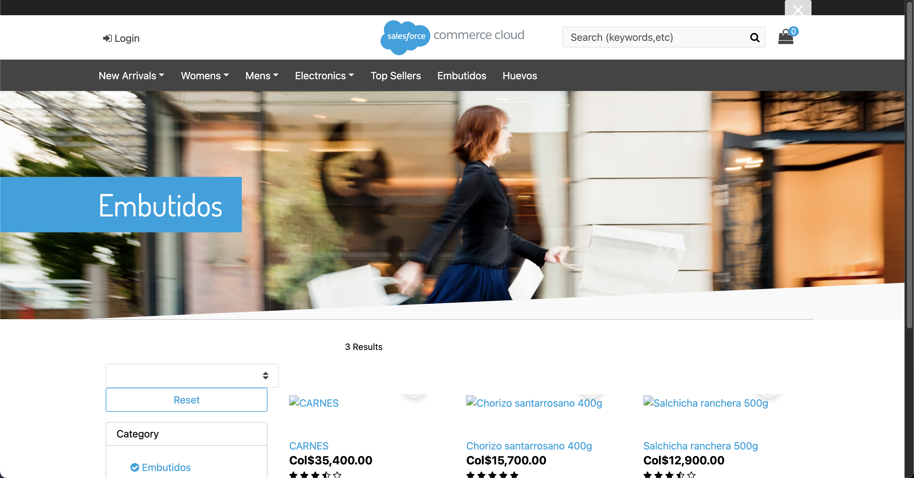

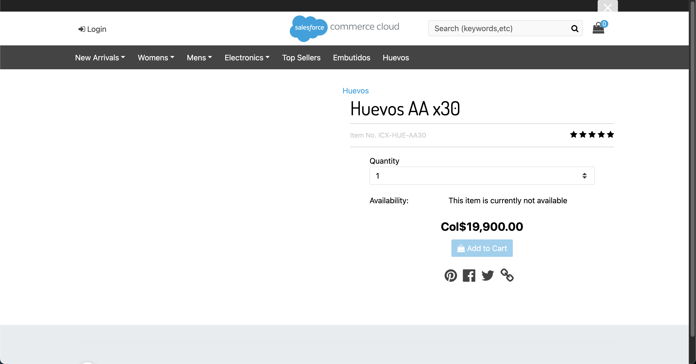

### E.7 Job programado

**Dónde:** Execute Anonymous, `ICX_PriceSyncScheduler.scheduleDaily(2)` (`scripts/apex/icx-programar-job.apex`).

**Resultado:** job "ICX PriceSync CRM → Commerce" programado todos los días a las 02:00, visible en Setup › Scheduled Jobs. Es el punto adicional que la prueba valora.

## Resumen de criterios de aceptación

| CA | Resultado | Evidencia |
|---|---|---|
| CA1 Carga inicial | 4 productos creados con precio en una ejecución, 0 errores | E.1, capturas E01–E03 |
| CA2 Producto nuevo | Producto agregado en vivo creado con precio en la siguiente ejecución | E.3 |
| CA3 Sin duplicados | Re-ejecuciones sin crear productos; precio cambiado en CRM actualizado en Commerce | E.2, captura E02 |
| CA4 Tienda | Productos visibles en su categoría con nombre y precio en pesos, en la tienda ICX | E.4–E.6, capturas E19–E20 |

**URLs para la sustentación**
- Flow: `https://enterprise-efficiency-9228--mkt.sandbox.lightning.force.com/flow/ICX_Sincronizar_Lista_Commerce`
- Log: `https://enterprise-efficiency-9228--mkt.sandbox.lightning.force.com/lightning/o/Commerce_Sync_Log__c/list?filterName=Todos`
- Tienda ICX: `https://blsb-001.dx.commercecloud.salesforce.com/s/ICX/huevos` y `/s/ICX/embutidos`
- Business Manager: `https://blsb-001.dx.commercecloud.salesforce.com/on/demandware.store/Sites-Site`
